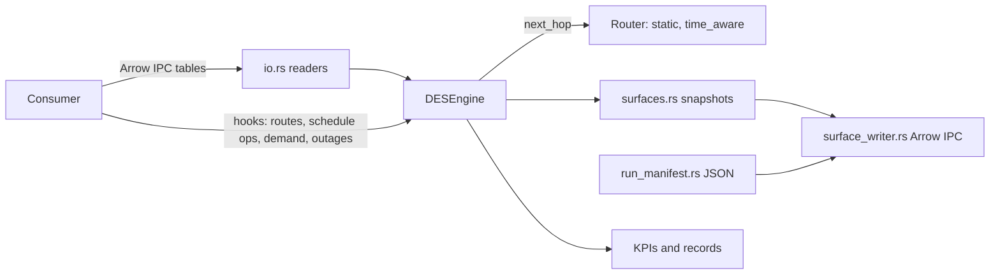

# EDD: how Ephemeris Kernel is built

Written on 2026-11-11 from commit `9c2525f`. It records the design as it is; the contract is in `docs/ERD.md`.

## Context and scope

Ephemeris is three Rust crates in one Cargo workspace (`Cargo.toml`) and a thin Python package (`python/ephemeris/`), built with maturin (`pyproject.toml`). This document covers their structure, tests, cost and risks. Consumers and their policies are out of scope.

## Design

Crates:
- `crates/ephemeris-des`, imported as `ephemeris._engine`. `events.rs` is a min-heap ordered by `(time_atu, event_id)`. `engine.rs` processes `Inject`, `Arrive`, `Depart`, `Deliver` and `WakeQueue` events, and enforces slot capacity, pinned reservations and outages. `router.rs` and `time_router.rs` implement the `Router` trait. `feasibility_oracle.rs` computes earliest arrival without capacity. `surfaces.rs` and `surface_writer.rs` build the per-bucket frames. `run_manifest.rs` stamps provenance, with the build SHA from `build.rs`. `python.rs` is the PyO3 boundary.
- `crates/ephemeris-fsm`, imported as `ephemeris_fsm_py`. Entities move from `Created` to `Delivered` or `Failed`. `propose` is pure and `commit_envelope` is the only mutation (`src/machine.rs`). Envelopes carry ledger-operation hints without importing the ledger.
- `crates/ephemeris-ledger`, imported as `ephemeris_ledger_py`. Reservations sit at `Forecast`, `Soft` or `Hard` level under an atomic version counter. Storage is a `DashMap` of `BTreeMap`, which keeps per-key order deterministic (`src/ledger.rs`).

Boundaries: the three crates do not import one another; a consumer composes them. The engine keeps its own slot reservations for pinned routes and does not use the ledger crate. Nothing in the repository imports a consumer, and `tests/test_no_domain_vocabulary.py` keeps it that way.

Reused libraries: `arrow` 55, `pyo3` 0.24, `serde`, `serde_json`, `thiserror`, `sha2`, `dashmap` and `parking_lot`. `h3o`, `proptest`, `criterion` and `rayon` are development dependencies only.

Data flow: the consumer builds the tables and constructs `PyEngine`. It may call `emit_run_manifest`, then either `run(horizon_atu)` or a loop of `step_until` and `drain_surfaces_arrow`. Each drain returns Arrow bytes whose schema metadata carries the manifest.

Packaging: the root `pyproject.toml` builds only `ephemeris-des`. The FSM and ledger install separately from their subdirectories (`README.md`, "Install"). When `CARGO_TARGET_DIR` is set, `scripts/route-native-extension.py` moves the editable native library into Cargo's output directory and links it back; otherwise it leaves maturin's default layout.

## Alternatives considered

| Chosen | Not chosen | Why, and where it is recorded |
|---|---|---|
| Arrow IPC inputs | JSON loading | replaced (`io.rs` header) |
| Node-to-cell mapping as input data | H3 computed at run time | the engine does no H3; `h3o` only checks equivalence in a test (`crates/ephemeris-des/Cargo.toml`) |
| JSON manifest | Parquet run store | deferred, JSON is enough for v1 (`run_manifest.rs`) |
| Single thread | Partitioned parallel executor | deferred, fields reserved (`run_manifest.rs`) |
| Fingerprint over sorted names | Fingerprint over ordered columns | a reorder keeps the fingerprint; `SCHEMA_VERSION` covers order (`surface_writer.rs`) |
| Drain and rebuild in `EventQueue::retain` | `BinaryHeap::retain` | chosen for clarity (`events.rs`) |
| `sha2` crate | SHA-256 written locally | maintained, pure Rust, no C dependency (`crates/ephemeris-des/Cargo.toml`) |
| Two neutrality lists | One list banned everywhere | only the README may name the consumer (commit `60e556f`) |
| Native library in Cargo's output directory | maturin's default inside the package | build output stays out of the source tree (commit `9c2525f`) |

## Tests

Sizes: small runs under 1 s with no I/O, medium under 30 s with local I/O, large is the rest. Counts and times are from `make test` on 2026-11-11.

| Size | Tests | What they prove |
|---|---|---|
| Small | 192 Rust tests: 80 engine unit tests; FSM 16 unit, 47 integration, 2 proptest; ledger 14 unit, 31 integration, 2 proptest | event order, conservation, capacity, routing, outages, pinned plans, legal transitions, the commitment lattice, versions, snapshot order |
| Medium | `manifest_writes_to_run_dir` (temporary directory); `tests/test_no_domain_vocabulary.py`, 2 tests over tracked files; `tests/test_native_output_routing.py`, 13 tests in temporary directories | the manifest lands where promised; neutrality; routing never overwrites or follows a symlink |
| Large, not in the check | `crates/ephemeris-fsm/python/tests/`, `crates/ephemeris-ledger/python/tests/` (need built extensions); criterion benchmarks | the FSM and ledger Python bindings; speed |

`crates/ephemeris-des/tests/h3_equivalence.rs` holds 3 small tests, but `make test-rust` passes `--lib`, so they do not run.

The check before every push to `main` is `make test`: `make test-rust` (the three crates with `--no-default-features`, without Python linkage), then `make guard` (`pytest tests -q`). It passed on 2026-11-11 in 6.2 s wall with a warm build cache. The repository has no CI.

Gaps: no test compares output bytes (R1), and no test drives `ephemeris._engine` from Python (R2).

## Security, privacy and observability

- No network I/O, no secrets, no personal data. Inputs are bytes from the caller, and parse errors become Python exceptions.
- `time_router.rs` declares `unsafe impl Send` and `Sync` for `TimeAwareRouter`, which holds a `RefCell` cache. That is sound only while one thread uses a router. PyO3's `&mut self` borrow check stops two threads from running one engine at once.
- `build.rs` runs `git rev-parse` at build time; outside a checkout the SHA is `unknown`.
- The routing script refuses a symlinked or directory destination and an output inside the package (`tests/test_native_output_routing.py`).
- Observability: every surface stream carries the manifest. `StrandSite` says where each strand was decided, and a non-zero `MissedPinnedSlot` count flags a bug (`src/types.rs`). The hop trace is opt-in. KPIs report `events_processed` and wall time. There is no logging.

## Cost

- Money: none. No CI, deploy, paid API or hosted service.
- Compute to run: one process, one thread, in memory. No baseline speed is recorded (`docs/ERD.md`, Budgets).
- Compute to build: `make test` takes 6.2 s warm. A cold build compiles Arrow and PyO3 and was not measured.
- Tokens and time to build a change: each change is small and comes with its tests; none needs a paid service.

## Risks, rollout and the way back

| Risk | Mitigation |
|---|---|
| A new `HashMap` iteration feeds an output and breaks byte identity without failing a test | R1; sort before accumulating, as `finalize_strands` does |
| A column reorder keeps the fingerprint but breaks positional readers | bump `SCHEMA_VERSION`; a test pinning column order |
| No pinned Rust toolchain: there is no `rust-toolchain.toml`; `rustc` 1.98.0 was used on 2026-11-11 | open question 1 |
| The `[profile.release]` blocks (`lto = true`, `codegen-units = 1`) sit in member crates; Cargo ignores them in a workspace and warns | R7 |
| Four `Cargo.lock` files (workspace and each crate) can drift; all pin `arrow` 55.2.0 today | regenerate them together |
| Comments cite code that is not in this repository (a TypeScript reader in `surface_writer.rs`, "Sacred Contract" labels in `types.rs`, external paths in `tests/h3_equivalence.rs`) | R6 |

Rollout: changes land on `main` after `make test`. Consumers install by tag (`@v0.1.0` in `README.md`), so `main` can move without breaking them. A change to output bytes ships with a new `SCHEMA_VERSION` and a new tag.

The way back: revert the commit on `main`. Consumers stay on their tag until they choose to move.

## Open questions

1. Pin the Rust toolchain, or record the `rustc` version in the manifest, so byte identity can be checked across builds?
2. Should the FSM and ledger Python tests run before every push, given that they need a maturin build?
3. `planner_git_sha` always equals `simulator_git_sha` (`run_manifest.rs`). Is it still needed?
